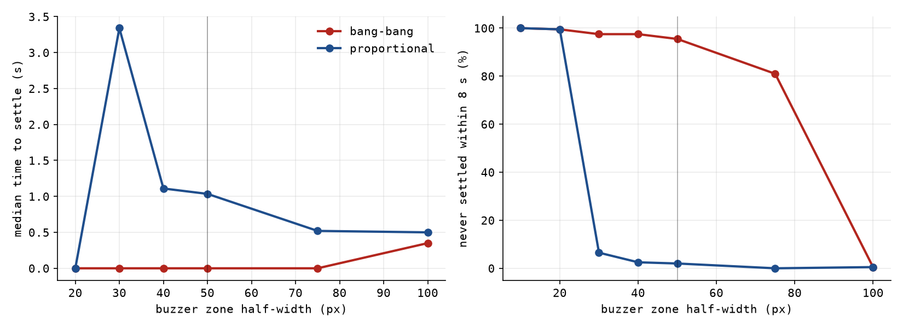
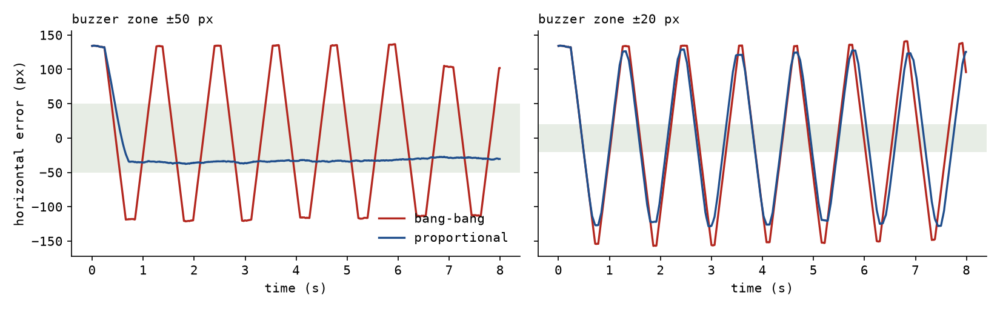

# four-leds

**Can a person steer a camera onto a target when the only feedback is four LEDs?**

April 2024: a laptop runs YOLOv5 on a webcam, finds a bottle and remembers
where it sat still for three seconds. Move the camera away and an Arduino
lights the way back, while a buzzer sounds when you're there:

| LED | means | pin |
|---|---|---|
| red | move left | 10 |
| green | move right | 11 |
| white | move up | 12 |
| blue | move down | 13 |
| buzzer | you're within ±50 px | 9 |

A push button on pin 2 forgets the target and starts over. (The 2024 README
listed different pins. The table above is what `origin/Indicate/Indicate.ino`
actually does.)

It worked on my desk. But nothing about it was ever measured, and it's a
control loop: the *sensor* is a neural net, the *controller* is a person, and
the *signal* between them is four bits. Control loops can be analysed.

## The person, as a control-theory textbook would draw them

They see the LEDs ~250 ms late (a typical visual reaction time), move the
camera at a comfortable ~600 px/s in whichever direction is lit, and their
hand shakes a little. Detections arrive at ~15 Hz. Each zone size gets 200
tries from random starting points.

Two displays are compared:

- **bang-bang (2024).** Each LED is on or off.
- **proportional.** The same LEDs, PWM-dimmed with the size of the error, so
  the person slows down as they approach.



| buzzer zone | bang-bang: never settled | proportional: never settled | proportional: median settle |
|---:|---:|---:|---:|
| ±20 px | 99.5 % | 99.5 % | — |
| ±30 px | 97.5 % | 6.5 % | 3.34 s |
| **±50 px (2024)** | **95.5 %** | **2.0 %** | **1.04 s** |
| ±75 px | 81.0 % | 0.0 % | 0.52 s |
| ±100 px | 0.5 % | 0.5 % | 0.50 s |



## Why it hunts

The arithmetic fits on a sticky note. At 600 px/s with a 250 ms delay, the
camera travels **150 px** after the LED changes and before the hand does. The
2024 zone is only 100 px wide, so a person who obeys the LEDs exactly sails
straight through, sees the opposite LED, and sails back. Forever. The LEDs
never said *slow down*; real people only managed because they slowed down on
their own.

Dimming the LEDs adds the missing *slow down* and the loop settles. Until you
shrink the zone too far: at ±20 px even the proportional display oscillates.
Its effective gain (600 px/s over an 80 px ramp, 7.5 s⁻¹) times the 0.25 s
delay is about 1.9, past the ~π/2 where a delayed loop stops being stable.
The fix there is lower gain, not more LEDs.

This is the same problem an underwater vehicle has when it centres itself
on a gate from a camera: a detector that updates slowly, a delay before the
thrusters respond, and a controller that has to brake before it arrives.
Later vehicles taught me that properly. This four-LED rig taught it first.

## v2: the rig, rebuilt with a "slow down"

The fix the simulation points at is cheap: dim the LEDs in proportion to the
error. Building it on a real Uno meets two pieces of silicon trivia that are
worth knowing:

- **PWM only exists on pins 3, 5, 6, 9, 10 and 11.** v1 had white and blue on
  12 and 13, which can only be on or off. You can't dim a pin that can't PWM.
- **`tone()` borrows Timer2, which also drives PWM on pins 3 and 11.** The
  buzzer and a dimmable green LED on 11 can't coexist. So green moves to 9 and
  the buzzer to 3, where losing PWM costs nothing.

| LED | means | v1 pin | v2 pin |
|---|---|---:|---:|
| red | move left | 10 | 10 |
| green | move right | 11 | **9** |
| white | move up | 12 | **6** |
| blue | move down | 13 | **5** |
| buzzer | you're there | 9 | **3** |

- [`rig/fourleds_v2/fourleds_v2.ino`](rig/fourleds_v2/fourleds_v2.ino): reads
  `E <dx> <dy>` lines (signed error, % of "far"), sets each LED's brightness from
  its share of the error, sounds the buzzer inside the zone, and goes dark if the
  laptop stops talking for 400 ms rather than show a stale direction. 6,564 bytes
  on an Uno.
- [`rig/main_v2.py`](rig/main_v2.py): YOLOv8 for the bottle, the same hold-still-3-s
  ideal spot, sends the proportional error, `--dry-run` without an Arduino.
- `tests/test_rig.py` pins the protocol and keeps the 2024 precedence bug on
  record, reproduced verbatim.

## Run it

```bash
python -m venv .venv && . .venv/bin/activate
pip install -r requirements.txt
python -m fourleds.run       # ~15 s, the human-in-the-loop study, rewrites assets/*.png
pytest -q                    # the v2 protocol, and the v1 bug, on record

arduino-cli compile -b arduino:avr:uno rig/fourleds_v2
pip install ultralytics pyserial && python rig/main_v2.py --port /dev/ttyUSB0
```

## The original rig

`origin/main.py` and `origin/Indicate/Indicate.ino` are the 2024 code, with
pinned requirements in `origin/requirements.txt`, and `README-2024.md` is its
README. `torch.hub` fetches YOLOv5 on first run. The precedence bug is left
in place there on purpose: `main.py` sends `leftdown` instead of `left,down`.
It works anyway, because the Arduino only checks whether each word appears.
Two bugs cancelling out is still two bugs.
